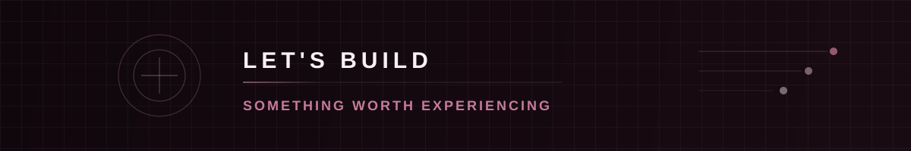

  

  
  
  

<h2 align="center">Web Developer | AI Automation | Web Technologies</h2>

  Web developer with 2+ years of practical experience building responsive websites, business applications, e-commerce solutions, and automation workflows.

---

## About Me

I build practical digital experiences that are functional, responsive, and easy to use. My current focus is on web development, AI automation, and scalable online systems that support business growth and operations.

**Professional focus:** Web Development · AI Automation · Business Applications · E-commerce · API Systems

---

## Skills & Technologies

| Area | Technologies |
|---|---|
| **Frontend** | HTML5, CSS3, JavaScript, TypeScript, React, Next.js, React Native, Tailwind CSS, responsive design |
| **CMS & E-commerce** | WordPress, Elementor, Divi, WooCommerce, Shopify, Liquid |
| **Backend & APIs** | Node.js, Express.js, REST APIs, authentication, API integration |
| **Databases** | MySQL, PostgreSQL, Firebase/Firestore, Supabase, SQL |
| **AI & Automation** | Generative AI, LLM APIs, AI agents, prompt engineering, AI automation, RAG concepts |
| **Cloud & DevOps** | Vercel, Netlify, Hostinger, Docker, Google Cloud, AWS, Microsoft Azure |
| **Tools & Analytics** | Git, GitHub, Trello, Jupyter, VS Code, Python, Pandas, NumPy, Power BI, Excel, data visualization |

---

## Featured Projects

<table>
  <tr>
    <td width="50%" valign="top">
      <h3>🌐 Emerging World</h3>
      Web development, AI automation, and digital solutions.
        
      
    </td>
    <td width="50%" valign="top">
      <h3>🚕 Fix My Cab</h3>
      Cab booking and fare platform with route logic, admin controls, MySQL persistence, and Razorpay payments.
        
      
    </td>
  </tr>
  <tr>
    <td width="50%" valign="top">
      <h3>📚 Library Management System</h3>
      Firebase-based library platform with seat allocation, fee management, and owner/student dashboards.
        
      
    </td>
    <td width="50%" valign="top">
      <h3>🌍 GlobeDirectory</h3>
      Worldwide business directory for discovering enterprises and services.
        
      
    </td>
  </tr>
  <tr>
    <td width="50%" valign="top">
      <h3>✨ AI Content Generator</h3>
      AI-powered content-generation application for business and creative workflows.
        
      
    </td>
    <td width="50%" valign="top">
      <h3>🎟️ Event Manager & Smart ID Pass Generator</h3>
      Event registration, QR-based identification, and attendee management with ID-card generation.
        
      
    </td>
  </tr>
</table>

---

## Professional Experience

| Role | Organization | Period |
|---|---|---|
| **Web Developer** | Digital Brahmans | October 2024 – Present |
| **Data Analyst** | The Website Maker | July 2023 – October 2023 |
| **Website Designer** | Technex, IIT (BHU) | August 2022 – September 2022 |

---

## GitHub Contribution Activity

  <picture>
    <source media="(prefers-color-scheme: dark)" srcset="https://raw.githubusercontent.com/sagarsaini-tech/sagarsaini-tech/output/github-contribution-snake-dark.svg" />
    <source media="(prefers-color-scheme: light)" srcset="https://raw.githubusercontent.com/sagarsaini-tech/sagarsaini-tech/output/github-contribution-snake.svg" />
    
  </picture>

<em>Every contribution is a step forward.</em>

---

## Connect With Me

  
  
  
  
  
  

  

